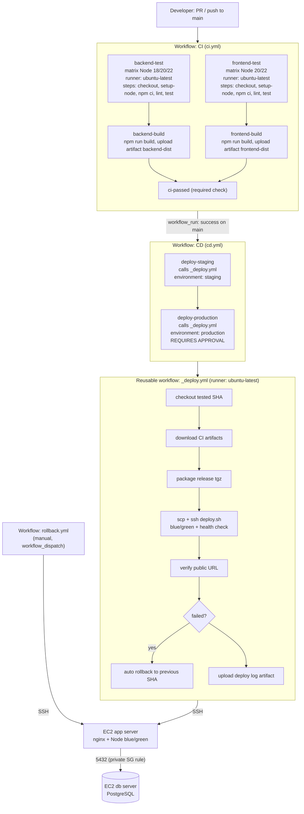

# ShopNest: Automated CI/CD for a Three-Tier App (GitHub Actions + AWS EC2)

> Live URLs: production `http://<APP_IP>/` , staging `http://<APP_IP>:8080/` (**TODO: fill after provisioning**)
> Status: see [Progress log](#progress-log-steps-commands-reasons-results) at the bottom.

## 1. Overview

| Tier | Tech | Where it runs |
|---|---|---|
| Presentation | React (Vite), built to static files | nginx on the app EC2 instance |
| Application | Node.js / Express REST API (`/health`, `/api/version`, `/api/products`) | two blue/green Node processes (systemd) on the app EC2 instance |
| Data | PostgreSQL 16 | separate EC2 instance, firewall only admits the app server's security group |

```
.
├── backend/            Express API, Jest tests, ESLint
├── frontend/           React app, Vitest tests, ESLint
├── deploy/             server-side tooling (deploy.sh, systemd unit, nginx template, bootstrap)
├── infra/provision.sh  AWS CLI provisioning (security groups, key pair, 2 EC2 instances)
├── .github/workflows/  ci.yml, cd.yml, _deploy.yml (reusable), rollback.yml
└── docs/               screenshots and evidence
```

## 2. Part A: CI/CD concepts (for management)

- **Continuous Integration (CI)**: every change is automatically installed, linted, tested and built as soon as it is pushed. Goal: find broken code in minutes.
- **Continuous Delivery**: every change that passes CI is automatically prepared and *can* be released, but a human presses the button for production.
- **Continuous Deployment**: every change that passes CI goes to production automatically, with no human step.

| Incident | How the pipeline fixes it |
|---|---|
| Broken build reached production | CD is triggered only by a **successful** CI run (`workflow_run` + `conclusion == 'success'`). The `main` branch is protected: PRs cannot merge unless the `CI passed` check is green. |
| ~10 min downtime per deploy | **Blue/green** release: the new version starts next to the old one, is health-checked, then nginx is gracefully reloaded to point at it. Users never hit a stopped service. |
| 2 h to restore last good version | Every release lives in `/opt/shopnest/<env>/releases/<commit-sha>`. Failed health checks **auto-roll back**, and the `Manual rollback` workflow can restore any retained version in about a minute. |
| Secrets in repo history | No credentials in git. Everything lives in GitHub Environment secrets/variables; the repo started clean (see Part D). |

**Choice: Continuous Delivery for production, Continuous Deployment for staging.** Merges to `main` deploy to staging automatically. Production then waits for a reviewer's approval (GitHub Environment protection rule). For a small e-commerce startup handling real money, a human gate on production is a cheap safety net, while staging gets the speed of full automation.

## 3. Parts B and C: CI and workflow architecture



How each requirement is met:
- **Separate CI and CD workflows**: `ci.yml` vs `cd.yml` (+ reusable `_deploy.yml`, `rollback.yml`).
- **Job dependencies**: build jobs `needs` test jobs; `ci-passed` needs both builds; production `needs` staging.
- **Parallelism**: backend and frontend chains run in parallel; matrix entries run in parallel.
- **Artifacts between jobs/workflows**: `backend-dist` and `frontend-dist` are uploaded by CI and downloaded by CD using the CI `run-id`, so **the exact bits that passed CI are what is deployed**.
- **Multi-runtime**: backend tests on Node 18, 20, 22; frontend on 20, 22.

## 4. Part D: Secrets and configuration

Branch protection (Settings, Branches, rule for `main`): require pull request, require status check **`CI passed`**, require branches up to date.

GitHub Environments: `staging` (no reviewers) and `production` (**Required reviewers** = you). Each has its own values.

| Name | Kind | Scope | Purpose |
|---|---|---|---|
| `SSH_PRIVATE_KEY` | secret | staging, production | private key used by the runner to SSH into the app server |
| `SSH_KNOWN_HOSTS` | secret | staging, production | pinned host key of the server (prevents MITM; `StrictHostKeyChecking yes`) |
| `SSH_HOST` | secret | staging, production | address of the app server |
| `DB_PASSWORD` | secret | per environment (different values) | password of that environment's database role |
| `SSH_USER` | variable | staging, production | SSH login user on the server |
| `DB_HOST` | variable | staging, production | private address of the DB server |
| `DB_NAME` | variable | per environment | database name (`shopnest_staging` / `shopnest_production`) |
| `DB_USER` | variable | per environment | database role |
| `APP_URL` | variable | per environment | public base URL (staging uses port 8080, production port 80) |

The runtime config file `/etc/shopnest/<env>/backend.env` is created on the server from stdin at deploy time (mode 640, root:shopnest). Nothing sensitive is committed; `.gitignore` blocks `.env`, `*.pem`, `*.key`, `infra/.out/`.

## 5. Parts E, F, G: deployment, zero downtime, health checks, rollback

**Deployment flow (`deploy/deploy.sh`)**
1. CD uploads `release-<sha>.tgz`, extracts it to `/opt/shopnest/<env>/releases/<sha>` (this is the traceability link; `VERSION` file, `/api/version`, the page footer and the GitHub Deployment all show the same SHA).
2. `npm ci --omit=dev`, then start the new backend on the *idle* port (blue/green: 3001/3002 prod, 3101/3102 staging).
3. Wait until the new instance reports `status: ok` **and** `version == <sha>` on `/health` (includes a DB check). If it never does, the new instance is stopped and the old keeps serving (**automatic rollback, zero impact**).
4. Switch the nginx upstream file and `nginx -s reload` (graceful), swap the `current` symlink for the frontend atomically, re-verify through nginx; revert if it fails.
5. Drain 5 s and stop the old instance. Keep the 5 latest releases.
6. CD then checks the public URL from outside; on failure the workflow calls `deploy.sh rollback <env> <previous-sha>`.

**Strategy and trade-offs**: blue/green on one host. Pros: no downtime, instant revert, no extra servers. Cons: not highly available (single host), needs 2x backend memory briefly, DB schema changes must be backward compatible with both versions.

**Manual rollback**: Actions, `Manual rollback`, choose environment and a SHA that is still on the server (`deploy.sh history` is printed by the workflow).

**Logs**: `/var/log/shopnest/deploy-<env>.log` on the server, also uploaded as an artifact (90 days) on every run.

## 6. Parts H and I

Copilot usage, failure scenarios and screenshots are documented in [docs/README-evidence.md](docs/README-evidence.md) (**to be completed with your Copilot prompts and screenshots**).

## 7. Reproduce this setup

1. Create a public GitHub repo, push this project (use PRs after the first commit).
2. `aws configure` (any region; default `us-east-1`).
3. `infra/provision.sh network`, `infra/provision.sh instances`, wait about 3 minutes, `infra/provision.sh bootstrap`.
4. Create the two GitHub Environments and add the secrets/variables from the table above (values from `infra/.out/`).
5. Enable branch protection and the production reviewer rule.
6. Open a PR; after merge CI, then staging, then (approval) production deploys.

---

## Progress log (steps, commands, reasons, results)

| # | Step | Command / action | Reason | Result |
|---|---|---|---|---|
| 1 | Read assignment | read `GITHUB ACTIONS.docx` | understand requirements (parts A-I) | 9 parts, 100 marks |
| 2 | Choices agreed with you | questions | stack/infra decisions | React+Express+PostgreSQL; 2 EC2 (app public, DB firewalled); you create the repo/secrets; AWS CLI provisioning |
| 3 | Tool check | `mkdir -p ...; git init; node -v; aws --version` | create folders, check tools | folders created. `aws-cli 2.35.4` OK. `git init` and `node` were blocked by the sandbox, need to be run with your approval |
| 4 | Wrote app, workflows, deploy scripts, provision script | file creation | implement parts B-G | files in repo; `bash -n` syntax check of all scripts passed |
