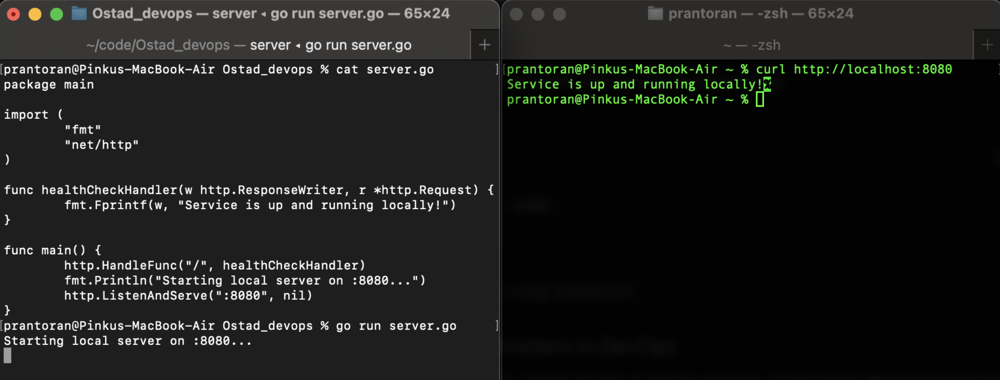
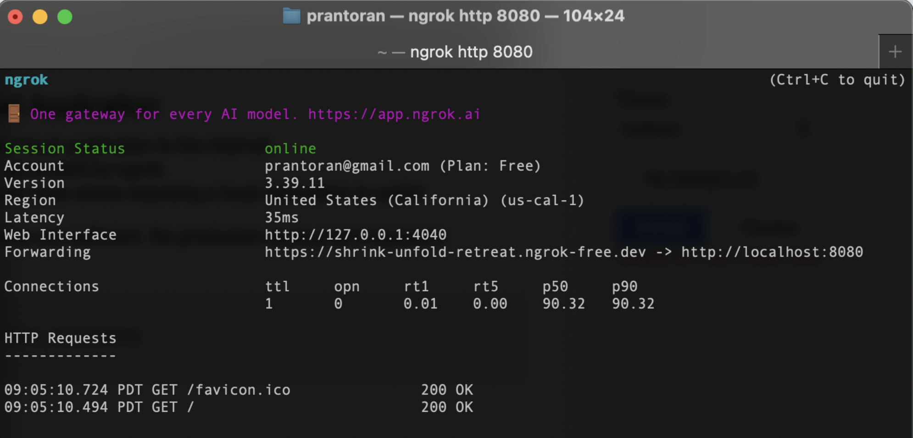

**Mastering DevOps: From Fundamentals to Advanced Practices**

**Assignment Report on Module 1 Assignment**

# Part A: Theoretical Questions 

## Explain what DevOps Engineering is. How does it differ from traditional development and operations roles?

DevOps Engineering is a philosophy, and set of technical practices designed to bridge the gap between software development (Dev) and IT operations (Ops). It focuses on automating processes, enhancing collaboration, and accelerating the delivery of high-quality software.

* **Traditional Roles:** Historically, development and operations worked in silos. Developers focused on writing code and pushing new features quickly. Once the code was "done," it was thrown over the proverbial wall to Operations. Ops teams prioritized system stability and uptime, making them naturally resistant to rapid changes. This conflict of interest caused slow release cycles, finger-pointing during failures, and poor system reliability.  
* **The DevOps Difference:** DevOps unifies these roles into a continuous loop of shared responsibility. Instead of manual deployments and siloed communication, DevOps relies on automation, continuous feedback, and treating infrastructure as code. Both teams share the same goal: delivering reliable features to users as efficiently as possible.

## Describe how DevOps fits into the Software Development Life Cycle (SDLC). Mention at least three SDLC phases where DevOps adds value.

DevOps transforms the SDLC from a linear, disjointed process (like the Waterfall model) into an agile, continuous loop. It integrates deeply into nearly every phase of the lifecycle:

* **Build Phase:** DevOps introduces Continuous Integration (CI), where code commits automatically trigger builds and static code analysis. This ensures that the main codebase is always in a deployable state.  
* **Test Phase:** Instead of manual QA at the end of a cycle, DevOps automates unit, integration, and security testing within the CI pipeline. If a build fails a test, it is immediately rejected, catching bugs before they reach production.  
* **Deploy/Operate Phase:** Through Continuous Deployment/Delivery (CD), validated code is automatically pushed to staging or production environments. Once live, DevOps ensures the application is monitored with automated alerting, feeding real-time performance data back to the development team to inform the next planning phase.

## What values does a DevOps Engineer bring to an organization? Explain any four values with examples.

A DevOps Engineer acts as a force multiplier for an engineering team. Four key values include:

* **Velocity and Speed:** By automating CI/CD pipelines, teams can deploy code dozens of times a day rather than once a month. *Example:* Automating the packaging of a media streaming service allows developers to push updates without waiting for a manual release window.  
* **Reliability:** Automation removes human error from deployments and infrastructure provisioning. *Example:* Using Infrastructure as Code (IaC) to spin up identical cloud environments ensures that code behaves the same way in staging as it does in production.  
* **Scalability:** DevOps engineers design systems that can automatically grow with demand. *Example:* Configuring container orchestration rules to automatically spin up additional web servers during a spike in user traffic, and scaling them down when traffic subsides to save costs.  
* **Security (DevSecOps):** Integrating security checks directly into the deployment pipeline. *Example:* Automatically scanning container images for known vulnerabilities before they are allowed to be deployed to a cluster.

## Why is prior Software Engineering (SWE) experience considered helpful before becoming a DevOps Engineer?

DevOps is increasingly about software engineering applied to infrastructure. Modern infrastructure is code. A background in SWE, especially working with languages like Go, Python, or C++, provides a foundational understanding of version control, modular design, and system architecture. Furthermore, an engineer who has built and maintained complex backend systems or microservices deeply understands developer pain points. This empathy allows them to build better internal developer platforms and create CI/CD pipelines that actually help developers, rather than just adding bureaucratic hurdles.

## Explain why networking knowledge (DNS, ports, protocols, IP addressing) is important for DevOps roles.

Applications do not exist in a vacuum; they must communicate. A DevOps engineer is responsible for ensuring that microservices, databases, and users can connect reliably and securely. Understanding DNS, ports, protocols (TCP/UDP), and IP addressing is non-negotiable. Without this knowledge, diagnosing why a containerized application cannot reach an external API, or configuring a load balancer, routing rules, and VPC firewalls, becomes impossible. Tools like `tcpdump` or network log analyzers are only effective if the engineer understands the underlying packets and protocols they are looking at.

## What soft skills are essential for a DevOps Engineer? Explain how these skills help during incidents or failures.

Technical skills build systems, but soft skills save them when they break.

* **Clear Communication:** The ability to convey complex technical issues simply to both technical and non-technical stakeholders.  
* **Collaboration and Empathy:** Working alongside developers without assigning blame.  
* **Calm Under Pressure:** Outages are stressful. Panic leads to rash decisions (like hastily deleting a database table). Remaining objective and analytical is critical. During an incident, these skills foster a "blameless culture." Instead of asking "Who broke the build?", a good DevOps engineer asks, "What gap in our automated testing allowed this bug to reach production?"

## Explain the importance of patience and troubleshooting mindset in DevOps with a real-life example.

In complex distributed systems, the root cause of a failure is rarely obvious. A troubleshooting mindset involves systematically isolating variables, reading logs, and testing hypotheses, rather than blindly restarting servers and hoping the problem goes away.

* **Real-Life Example:** Suppose a microservice that intermittently drops connections during peak load. An impatient approach might be to simply double the CPU and memory allocation. A patient troubleshooting mindset would dictate analyzing the network traffic, inspecting the connection pooling configuration, and checking system logs. This methodical approach might reveal that the underlying issue is actually port exhaustion on the host machine, a problem that throwing more RAM at the server would never fix.

# Part B: Scenario-Based Questions

## A new student joins a DevOps course but is unfamiliar with GitHub and cloud platforms. How would you onboard this student efficiently using tools, documentation, and communication channels?

We can start with an interactive, low-stakes environment in order to efficiently onboard a beginner. We provide a centralized "Getting Started" wiki with step-by-step repository cloning and cloud console access instructions. Then we wair the student with a mentor for brief daily check-ins, and utilize interactive visual tools, like GitHub Learning Lab or cloud sandboxes, to help them build technical skills before assigning production tasks.

## During a production deployment, an application goes down unexpectedly. As a DevOps Engineer, describe step-by-step how you would troubleshoot and handle the situation.

When a deployment causes an outage, immediate restoration takes precedence over immediate investigation.

1. Triage and Communicate

Acknowledge the alert, declare an incident, and notify stakeholders that the team is actively investigating to prevent communication silos.

2. Execute Rollback

Revert the deployment to the last known good state. Attempting to apply hotfixes directly to production prolongs downtime and adds unnecessary risk.

3. Investigate Root Cause

Once the system is stable, analyze application logs, infrastructure metrics, and the specific commit diffs of the failed release in an isolated staging environment.

4. Conduct a Blameless Post-Mortem

Document what failed, why the automated tests missed the issue, and create action items to improve the deployment pipeline moving forward.

## Your team releases features frequently, but system stability is decreasing. How can DevOps practices help balance speed and reliability?

When velocity compromises stability, you must introduce structural guardrails to protect the user experience:

* **Canary Deployments:** Route only 5-10% of traffic to the new release initially. If error rates spike, the deployment automatically rolls back, minimizing the blast radius.  
* **Error Budgets:** Define strict Service Level Objectives (SLOs). If stability drops below the agreed threshold, feature releases are paused, and the team must focus entirely on reliability tasks until the budget recovers.  
* **Shift-Left Testing:** Integrate heavier automated integration, load, and security tests earlier in the CI pipeline to catch architectural failures well before the deployment phase.

## A team struggles with communication during incidents because members are distributed. How can proper onboarding to communication platforms improve DevOps workflows?

Distributed teams struggle during incidents when there is no single source of truth. Implement ChatOps by integrating alerting tools directly into a dedicated incident chat channel. Define strict incident roles—such as an Incident Commander who directs the flow of information while others troubleshoot—and run regular "game day" simulations to ensure remote team members know exactly where to communicate when real alerts fire.

# Part C: Technical / Practical Tasks 

## Task 1: Local DevOps Demo Application

Run any simple application locally (for example: a basic web server, demo app, or sample project).  
Verify that the application is running successfully on your local machine.  
Briefly explain how running applications locally helps in DevOps workflows.

```golang
package main
import (
    "fmt"
    "net/http"
)
func healthCheckHandler(w http.ResponseWriter, r *http.Request) {
    fmt.Fprintf(w, "Service is up and running locally!")
}
func main() {
    http.HandleFunc("/", healthCheckHandler)
    fmt.Println("Starting local server on :8080...")
    http.ListenAndServe(":8080", nil)
}
```



## Task 2: Exposing Local Application

1. Use ngrok to expose your local application to the internet.  
2. Capture the public URL generated by ngrok.  
3. Explain one real-world use case where exposing a local application is useful.

(Screenshots or short explanations are sufficient. No production deployment required.)

1. Create an account in [ngrok.com](http://ngrok.com)  
2. Copy and export NGROK\_AUTHTOKEN dashboard into terminal session.  
3. Run ngrok.

```bash
brew install ngrok
export NGROK_AUTHTOKEN=$YOUR_AUTHTOKEN
ngrok http 8080
```


