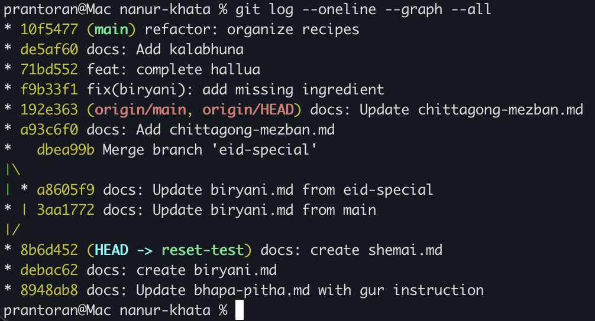

HW link: https://docs.google.com/document/d/1RORsINBGEe8FrGCzgmIsQTtSn2NLQrb2c_Q0cdulXmU/edit?tab=t.0

# Chapter 1: The First Recipe

## Task A
```bash
mkdir nanur-khata
```
- Created empty directory

```bash
git config --global user.name "Pinku Deb Nath"
git config --global user.email "prantoran@gmail.com"
```
- Set global user and email

```bash
git init
# Initialized empty Git repository in /Users/prantoran/nanur-khata/.git/
```
- Initialize empty .git

## Task B
```bash
touch bhapa-pitha.md
git status
# On branch main

# No commits yet

# Untracked files:
#  (use "git add <file>..." to include in what will be committed)
#	bhapa-pitha.md

# nothing added to commit but untracked files present (use "git add" to track)
```

```bash
git add bhapa-pitha.md
git status
# On branch main

# No commits yet

# Changes to be committed:
#  (use "git rm --cached <file>..." to unstage)
#	new file:   bhapa-pitha.md
```

## Task C
```bash
cat > bhapa-pitha.md << EOF
# heredoc> One and a half cups of gur, not two!
# heredoc> EOF
cat bhapa-pitha.md
# One and a half cups of gur, not two!
```

```bash
git diff
diff --git a/bhapa-pitha.md b/bhapa-pitha.md
index e69de29..322171e 100644
--- a/bhapa-pitha.md
+++ b/bhapa-pitha.md
@@ -0,0 +1 @@
```

```bash
git diff --staged
diff --git a/bhapa-pitha.md b/bhapa-pitha.md
new file mode 100644
index 0000000..e69de29
```

The difference in output between `git diff` and `git diff --staged` is due to 
`--staged` the staging area with the last commit (HEAD) while the first one compares
the working directory to the staging area (changes not staged for next commit).

## Task D

```bash
git commit -m "docs: Update bhapa-pitha.md with gur instruction"
[main (root-commit) 8948ab8] docs: Update bhapa-pitha.md with gur instruction
 1 file changed, 1 insertion(+)
 create mode 100644 bhapa-pitha.md
```

## Task E
```bash
touch bazar-list.txt
git add bazar-list.txt
git status
On branch main
Changes to be committed:
  (use "git restore --staged <file>..." to unstage)
	new file:   bazar-list.txt

git reset bazar-list.txt
git status
On branch main
Untracked files:
  (use "git add <file>..." to include in what will be committed)
	bazar-list.txt

nothing added to commit but untracked files present (use "git add" to track)
```

# Chapter 2: The Secret Spice
## Task A
```bash
touch secret-masala.txt
touch a.tmp b.tmp
mkdir draft
git status
On branch main
Untracked files:
  (use "git add <file>..." to include in what will be committed)
	a.tmp
	b.tmp
	bazar-list.txt
	secret-masala.txt

nothing added to commit but untracked files present (use "git add" to track)
```

## Task B
```bash
cat > .gitignore << EOF
heredoc> secret-masala.txt
heredoc> *.tmp
heredoc> draft/
heredoc> EOF
git status
On branch main
Untracked files:
  (use "git add <file>..." to include in what will be committed)
	.gitignore
	bazar-list.txt

nothing added to commit but untracked files present (use "git add" to track)
```

# Chapter 3:  The Eid Special
## Task A
```bash
git branch
* main
prantoran@Mac nanur-khata % git branch eid-special
prantoran@Mac nanur-khata % git checkout eid-special
Switched to branch 'eid-special'
prantoran@Mac nanur-khata % git branch
* eid-special
  main
```

## Task B
```bash
touch biryani.md
git add biryani.md
git commit -m "docs: create biryani.md"
[eid-special debac62] docs: create biryani.md
 1 file changed, 0 insertions(+), 0 deletions(-)
 create mode 100644 biryani.md

touch shemai.md
git add shemai.md
git commit -m "docs: create shemai.md"
[eid-special 8b6d452] docs: create shemai.md
 1 file changed, 0 insertions(+), 0 deletions(-)
 create mode 100644 shemai.md
```

## Task C
```bash
ls
a.tmp			biryani.md
b.tmp			draft
bazar-list.txt		secret-masala.txt
bhapa-pitha.md		shemai.md
```
```bash
git checkout main
ls
a.tmp			bhapa-pitha.md
b.tmp			draft
bazar-list.txt		secret-masala.txt
```

The files `biryani.md` and `shemai.md` are not present in the main branch.

```bash
git log --oneline
8948ab8 (HEAD -> main) docs: Update bhapa-pitha.md with gur instruction

git merge eid-special
Updating 8948ab8..8b6d452
Fast-forward
 biryani.md | 0
 shemai.md  | 0
 2 files changed, 0 insertions(+), 0 deletions(-)
 create mode 100644 biryani.md
 create mode 100644 shemai.md

git log --oneline
8b6d452 (HEAD -> main, eid-special) docs: create shemai.md
debac62 docs: create biryani.md
8948ab8 docs: Update bhapa-pitha.md with gur instruction
```

### Creating merge conflict

```bash
cat >> biryani.md << EOF
heredoc> From main
heredoc> EOF
git add biryani.md
git commit -m "docs: Update biryani.md from main"
[main 3aa1772] docs: Update biryani.md from main
 1 file changed, 1 insertion(+)
```

```bash
git branch
  eid-special
* main
git checkout eid-special
Switched to branch 'eid-special'
cat >> biryani.md << EOF
heredoc> From Eid-special
heredoc> EOF
git add biryani.md
git commit -m "docs: Update biryani.md from eid-special"
[eid-special a8605f9] docs: Update biryani.md from eid-special
 1 file changed, 1 insertion(+)
```

```bash
git branch
* eid-special
  main
git checkout main
Switched to branch 'main'
```
#### Conflict on merge
```bash
git merge eid-special
Auto-merging biryani.md
CONFLICT (content): Merge conflict in biryani.md
Automatic merge failed; fix conflicts and then commit the result.
```

```bash
git log --oneline
3aa1772 (HEAD -> main) docs: Update biryani.md from main
8b6d452 docs: create shemai.md
debac62 docs: create biryani.md
8948ab8 docs: Update bhapa-pitha.md with gur instruction
```

### Fix manually
```bash
cat biryani.md
<<<<<<< HEAD
From main
=======
From Eid-special
>>>>>>> eid-special
```

```bash
vim biryani.md
cat biryani.md
From main
From Eid-special
```

```bash
git commit
U	biryani.md
error: Committing is not possible because you have unmerged files.
hint: Fix them up in the work tree, and then use 'git add/rm <file>'
hint: as appropriate to mark resolution and make a commit.
fatal: Exiting because of an unresolved conflict.
```

```bash
git add biryani.md
```
```bash
git commit
<<<<<<< HEAD
From main
Merge branch 'eid-special'

# Conflicts:
#       biryani.md
#
# It looks like you may be committing a merge.
# If this is not correct, please run
#       git update-ref -d MERGE_HEAD
# and try again.


# Please enter the commit message for your changes. Lines starting
# with '#' will be ignored, and an empty message aborts the commit.
#
# On branch main
# All conflicts fixed but you are still merging.
#
# Changes to be committed:
#       modified:   biryani.md
#
# Untracked files:
#       .gitignore
"~/go/code/nanur-khata/.git/COMMIT_EDITMSG" 24L, 500B
Merge branch 'eid-special'

# Conflicts:
#       biryani.md
#
# It looks like you may be committing a merge.
# If this is not correct, please run
#       git update-ref -d MERGE_HEAD
# and try again.


# Please enter the commit message for your changes. Lines starting
# with '#' will be ignored, and an empty message aborts the commit.
#
# On branch main
# All conflicts fixed but you are still merging.
#
# Changes to be committed:
#       modified:   biryani.md
#
# Untracked files:
#       .gitignore

[main dbea99b] Merge branch 'eid-special'
```
#### Check logs
```bash
git log --oneline
dbea99b (HEAD -> main) Merge branch 'eid-special'
a8605f9 (eid-special) docs: Update biryani.md from eid-special
3aa1772 docs: Update biryani.md from main
8b6d452 docs: create shemai.md
debac62 docs: create biryani.md
8948ab8 docs: Update bhapa-pitha.md with gur instruction
```

# Chapter 4:  Mitu Joins In
## Task A
Create a GitHub repo, connect it with `git remote add origin [url]`, and `git push`.

```bash
gh repo create nanur-khata --public
✓ Created repository prantoran/nanur-khata on github.com
  https://github.com/prantoran/nanur-khata


A new release of gh is available: 2.94.0 → 2.102.0
To upgrade, run: brew upgrade gh
https://github.com/cli/cli/releases/tag/v2.102.0
```

```bash
git remote add origin https://github.com/prantoran/nanur-khata.git
git push -u origin main
```

## Task B
Play Mitu: `git clone` the repo into another folder, add chittagong-mezban.md and push.

```bash
git clone git@github.com:prantoran/nanur-khata.git
touch chittagong-mezban.md
git add chittagong-mezban.md
git commit -m "docs: Add chittagong-mezban.md"
git push
```

## Task C
Back in your folder, run `git fetch origin`, then `git merge origin/main`.
```bash
git fetch origin
remote: Enumerating objects: 3, done.
remote: Counting objects: 100% (3/3), done.
remote: Compressing objects: 100% (1/1), done.
remote: Total 2 (delta 1), reused 2 (delta 1), pack-reused 0 (from 0)
Unpacking objects: 100% (2/2), 245 bytes | 81.00 KiB/s, done.
From https://github.com/prantoran/nanur-khata
   dbea99b..a93c6f0  main       -> origin/main
```

```bash
git merge origin/main
Updating dbea99b..a93c6f0
Fast-forward
 chittagong-mezban.md | 0
 1 file changed, 0 insertions(+), 0 deletions(-)
 create mode 100644 chittagong-mezban.md
```

## Task D  
Mitu pushes again. This time use `git pull`.

```bash
cat > chittagong-mezban.md << EOF
heredoc> from Mitu
heredoc> EOF

git add chittagong-mezban.md
git commit -m "docs: Update chittagong-mezban.md"
[main 192e363] docs: Update chittagong-mezban.md
 1 file changed, 1 insertion(+)
git push
Enumerating objects: 5, done.
Counting objects: 100% (5/5), done.
Delta compression using up to 10 threads
Compressing objects: 100% (2/2), done.
Writing objects: 100% (3/3), 287 bytes | 287.00 KiB/s, done.
Total 3 (delta 1), reused 0 (delta 0), pack-reused 0
remote: Resolving deltas: 100% (1/1), completed with 1 local object.
To github.com:prantoran/nanur-khata.git
   a93c6f0..192e363  main -> main
```

```bash
git pull
remote: Enumerating objects: 5, done.
remote: Counting objects: 100% (5/5), done.
remote: Compressing objects: 100% (1/1), done.
remote: Total 3 (delta 1), reused 3 (delta 1), pack-reused 0 (from 0)
Unpacking objects: 100% (3/3), 267 bytes | 53.00 KiB/s, done.
From https://github.com/prantoran/nanur-khata
   a93c6f0..192e363  main       -> origin/main
Updating a93c6f0..192e363
Fast-forward
 chittagong-mezban.md | 1 +
 1 file changed, 1 insertion(+)
```

### Question: What is the difference between fetch + merge and pull?
`git pull` is a shortcut command that automatically executes `git fetch` followed immediately by `git merge`. The difference between the two approaches is entirely about control and review.
- `git fetch`: Downloads new commits, files, and references from the remote repository and updates your remote-tracking branches (like origin/main). It does not touch active local branch (main) or working directory.
	- Review: Because the remote changes are isolated in origin/main, we can safely inspect what has been added (e.g., using git diff main..origin/main) without altering any of the local files. 
- `git merge`: When we are ready, running `git merge origin/main` explicitly integrates those downloaded commits into the active local branch.
- `git pull`: Fetches the remote changes and immediately forces a merge into the currently checked-out branch.

# Chapter 5:  Half-Cooked Halua and Time Travel
Halfway through the halua recipe, Nanu calls: "You forgot cardamom in the biryani!"
## Task A  
Save the halua work with git stash, fix and commit the biryani, then git stash pop.

```bash
cat >> halua.md << EOF
heredoc> Add halua mix
heredoc> EOF
```

```bash
git status

On branch main
Your branch is up to date with 'origin/main'.

Untracked files:
  (use "git add <file>..." to include in what will be committed)
	halua.md

nothing added to commit but untracked files present (use "git add" to track)
```

```bash
git add halua.md
git status

On branch main
Your branch is up to date with 'origin/main'.

Changes to be committed:
  (use "git restore --staged <file>..." to unstage)
	new file:   halua.md
```

```bash
git stash
Saved working directory and index state WIP on main: 192e363 docs: Update chittagong-mezban.md
```

```bash
git status
On branch main
Your branch is up to date with 'origin/main'.

nothing to commit, working tree clean
```

```bash
cat biryani.md
From main
From Eid-special

cat >> biryani.md << EOF
heredoc> You forgot cardamom in the biryani!
heredoc> EOF

cat biryani.md
From main
From Eid-special
You forgot cardamom in the biryani!

git add biryani.md
git commit -m "fix(biryani): add missing ingredient"
[main f9b33f1] fix(biryani): add missing ingredient
 1 file changed, 1 insertion(+)

git stash pop
git commit -m "feat: complete hallua"
[main 71bd552] feat: complete hallua
 1 file changed, 2 insertions(+)
 create mode 100644 halua.md
```

## Task B
Organize recipes into folders with `git mv`, delete an old recipe with `git rm`, and check `git log --stat -M`.

```bash
```bash
mkdir sweets mains
git mv bhapa-pitha.md shemai.md halua.md sweets/
git mv biryani.md chittagong-mezban.md mains/
 git status
On branch main
Your branch is ahead of 'origin/main' by 2 commits.
  (use "git push" to publish your local commits)

Changes to be committed:
  (use "git restore --staged <file>..." to unstage)
	renamed:    biryani.md -> mains/biryani.md
	renamed:    chittagong-mezban.md -> mains/chittagong-mezban.md
	renamed:    bhapa-pitha.md -> sweets/bhapa-pitha.md
	renamed:    halua.md -> sweets/halua.md
	renamed:    shemai.md -> sweets/shemai.md

ls
kalabhuna.md	mains		sweets
git rm kalabhuna.md
git status
On branch main
Your branch is ahead of 'origin/main' by 3 commits.
  (use "git push" to publish your local commits)

Changes to be committed:
  (use "git restore --staged <file>..." to unstage)
	deleted:    kalabhuna.md

git commit -m "refactor: organize recipes"
[main 10f5477] refactor: organize recipes
 1 file changed, 0 insertions(+), 0 deletions(-)
 delete mode 100644 kalabhuna.md
```

```bash
git log --stat -M -n 2
commit 10f5477f04849943455966fe267d2563cdd8881c (HEAD -> main)
Author: Pinku Deb Nath <prantoran@gmail.com>
Date:   Sat Oct 17 23:20:40 2026 -0700

    refactor: organize recipes

 kalabhuna.md | 0
 1 file changed, 0 insertions(+), 0 deletions(-)

commit de5af609fbfdf296cec4e78512171845b6c6363a
Author: Pinku Deb Nath <prantoran@gmail.com>
Date:   Sat Oct 17 23:18:08 2026 -0700

    docs: Add kalabhuna

 shemai.md => kalabhuna.md                          | 0
 biryani.md => mains/biryani.md                     | 0
 chittagong-mezban.md => mains/chittagong-mezban.md | 0
 bhapa-pitha.md => sweets/bhapa-pitha.md            | 0
 halua.md => sweets/halua.md                        | 0
 sweets/shemai.md                                   | 0
 6 files changed, 0 insertions(+), 0 deletions(-)
```
- Using `git mv` stages both the deletion of the old path and the creation of the new path simultaneously, while `git log --stat -M` detects the similarity index (100%) and displays clean rename tracking (`{bhapa-pitha.md => sweets/bhapa-pitha.md}`) rather than treating them as lost and newly created files.

## Task C
Pick a commit and run git show [SHA].

```bash
git log --oneline
10f5477 (HEAD -> main) refactor: organize recipes
de5af60 docs: Add kalabhuna
71bd552 feat: complete hallua
f9b33f1 fix(biryani): add missing ingredient
192e363 (origin/main, origin/HEAD) docs: Update chittagong-mezban.md
a93c6f0 docs: Add chittagong-mezban.md
dbea99b Merge branch 'eid-special'
a8605f9 docs: Update biryani.md from eid-special
3aa1772 docs: Update biryani.md from main
8b6d452 docs: create shemai.md
debac62 docs: create biryani.md
8948ab8 docs: Update bhapa-pitha.md with gur instruction
```

```bash
git show 192e363

commit 192e363033d20c6a4f14e5a01152e7fdcfbb8f08 (origin/main, origin/HEAD)
Author: Pinku Deb Nath <prantoran@gmail.com>
Date:   Sat Oct 17 11:11:35 2026 -0700

    docs: Update chittagong-mezban.md

diff --git a/chittagong-mezban.md b/chittagong-mezban.md
index e69de29..14aa9bf 100644
--- a/chittagong-mezban.md
+++ b/chittagong-mezban.md
@@ -0,0 +1 @@
+from Mitu
```

## Task D
On a test branch, try `git reset --hard [older-commit]` and write down what you lost. Never do this on main!
```bash
git checkout -b reset-test
git log --oneline
10f5477 (HEAD -> reset-test, main) refactor: organize recipes
de5af60 docs: Add kalabhuna
71bd552 feat: complete hallua
f9b33f1 fix(biryani): add missing ingredient
192e363 (origin/main, origin/HEAD) docs: Update chittagong-mezban.md
a93c6f0 docs: Add chittagong-mezban.md
dbea99b Merge branch 'eid-special'
a8605f9 docs: Update biryani.md from eid-special
3aa1772 docs: Update biryani.md from main
8b6d452 docs: create shemai.md
debac62 docs: create biryani.md

git reset --hard 8b6d452
HEAD is now at 8b6d452 docs: create shemai.md
```
- What I Lost: Running `git reset --hard 8b6d452` forcibly moved the `reset-test` branch pointer backward by 9 commits to 8b6d452, and wiped both the staging area and the working directory to match that older snapshot.

### Question: Why are rebase and reset --hard dangerous on a shared branch?
1. They Rewrite Commit History: Both commands alter existing commit history—`git reset --hard` discards commits entirely, while `git rebase` replaces existing commits with brand-new commits that have different SHA-1 hashes.
2. Data Loss & Destroyed Work: `git reset --hard` permanently wipes uncommitted changes in the working directory and staging area without warning. If force-pushed (`git push --force`) to a shared branch like `main`, it overwrites commits that teammates (like Mitu) may have pushed in the meantime.

# Submission


