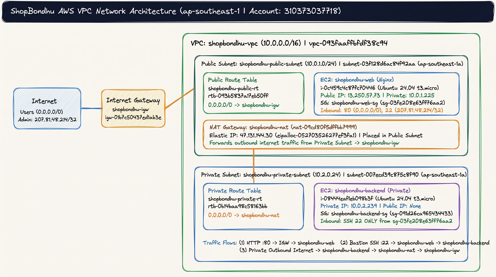

# Launch Day at ShopBondhu — AWS VPC & EC2 Deployment

## 1. Project Title & Short Description

ShopBondhu is an e-commerce startup in Dhaka launching its static landing page on a custom AWS network built from scratch. This project provisions an isolated VPC (`10.0.0.0/16`) with public and private subnets, an Internet Gateway, a NAT Gateway with an Elastic IP, custom route tables, least-privilege security groups, a public Nginx web server (`shopbondhu-web`), and a private backend server (`shopbondhu-backend`).

---

## 2. Architecture Diagram



---

## 3. Resources Created

| Resource | Name | CIDR / ID | Notes |
| --- | --- | --- | --- |
| VPC | `shopbondhu-vpc` | `10.0.0.0/16` (`vpc-093faaffbfdf38c94`) | Custom VPC in `ap-southeast-1` |
| Public Subnet | `shopbondhu-public-subnet` | `10.0.1.0/24` (`subnet-03f128d6ac84f92aa`) | `ap-southeast-1a`, Auto-assign public IPv4 enabled |
| Private Subnet | `shopbondhu-private-subnet` | `10.0.2.0/24` (`subnet-007ecd39c875c8f90`) | `ap-southeast-1a`, Auto-assign public IPv4 disabled |
| Internet Gateway | `shopbondhu-igw` | `igw-01b7c50437ed1ab3e` | Attached to `shopbondhu-vpc` |
| Elastic IP | `shopbondhu-nat-eip` | `47.131.144.30` (`eipalloc-05270352627ef3fa1`) | Attached to `shopbondhu-nat` |
| NAT Gateway | `shopbondhu-nat` | `nat-09cd80f5dffbb7999` | Placed in `shopbondhu-public-subnet` |
| Public Route Table | `shopbondhu-public-rt` | `rtb-093b5837a17eb50ff` | Route `0.0.0.0/0 -> shopbondhu-igw`, associated with public subnet |
| Private Route Table | `shopbondhu-private-rt` | `rtb-0b14baa98c58163bb` | Route `0.0.0.0/0 -> shopbondhu-nat`, associated with private subnet |
| Web Security Group | `shopbondhu-web-sg` | `sg-03fe208e63ff76aa2` | Inbound SSH (`22`) from `207.81.48.214/32`, HTTP (`80`) from `0.0.0.0/0` |
| Backend Security Group | `shopbondhu-backend-sg` | `sg-091d26ca965434433` | Inbound SSH (`22`) allowed only from `shopbondhu-web-sg` |
| Public Web EC2 | `shopbondhu-web` | `i-0c459c4c87fc70446` (`13.250.57.73` / `10.0.1.225`) | Ubuntu 24.04 LTS (`t3.micro`), Nginx web server & bastion host |
| Private Backend EC2 | `shopbondhu-backend` | `i-08444eaf1eb098b3f` (`10.0.2.239`) | Ubuntu 24.04 LTS (`t3.micro`), private subnet only |

---

## 4. Step-by-Step Setup

### Task 1: Create the VPC (`shopbondhu-vpc`)

Created a custom VPC named `shopbondhu-vpc` (`vpc-093faaffbfdf38c94`) with IPv4 CIDR block `10.0.0.0/16` in `ap-southeast-1`.


### Task 2: Create the Subnets (`shopbondhu-public-subnet` & `shopbondhu-private-subnet`)

Created `shopbondhu-public-subnet` (`10.0.1.0/24`) with Auto-assign public IPv4 enabled, and `shopbondhu-private-subnet` (`10.0.2.0/24`) with Auto-assign public IPv4 kept off.


### Task 3: Create and Attach Internet Gateway (`shopbondhu-igw`)

Created Internet Gateway `shopbondhu-igw` (`igw-01b7c50437ed1ab3e`) and attached it to `shopbondhu-vpc`.


### Task 4: Create NAT Gateway (`shopbondhu-nat`)

Allocated Elastic IP `47.131.144.30` (`eipalloc-05270352627ef3fa1`) and created `shopbondhu-nat` (`nat-09cd80f5dffbb7999`) inside `shopbondhu-public-subnet`.


### Task 5: Configure Route Tables (`shopbondhu-public-rt` & `shopbondhu-private-rt`)

Configured `shopbondhu-public-rt` (`rtb-093b5837a17eb50ff`) to route `0.0.0.0/0` to `shopbondhu-igw` and associated it with `shopbondhu-public-subnet`. Configured `shopbondhu-private-rt` (`rtb-0b14baa98c58163bb`) to route `0.0.0.0/0` to `shopbondhu-nat` and associated it with `shopbondhu-private-subnet`.


### Task 6: Launch EC2 Instances & Configure Security Groups

Launched `shopbondhu-web` (`i-0c459c4c87fc70446`, public IP `13.250.57.73`, private IP `10.0.1.225`) in the public subnet with `shopbondhu-web-sg` (SSH `22` from `207.81.48.214/32`, HTTP `80` from `0.0.0.0/0`), and `shopbondhu-backend` (`i-08444eaf1eb098b3f`, private IP `10.0.2.239`) in the private subnet with `shopbondhu-backend-sg` (SSH `22` from `shopbondhu-web-sg` only).


---

## 5. Nginx & Frontend Deployment

Connected to `shopbondhu-web` (`13.250.57.73`), installed and enabled Nginx, copied the ShopBondhu landing page (`frontend/index.html`, `frontend/style.css`, `frontend/script.js`) to `/var/www/html`, and reloaded Nginx:

```bash
ssh -i ~/.ssh/shopbondhu-key ubuntu@13.250.57.73
sudo apt update && sudo apt install -y nginx
sudo systemctl start nginx && sudo systemctl enable nginx
sudo systemctl status nginx

# Deploy static frontend files to /var/www/html
scp -i ~/.ssh/shopbondhu-key frontend/index.html frontend/style.css frontend/script.js ubuntu@13.250.57.73:/tmp/
ssh -i ~/.ssh/shopbondhu-key ubuntu@13.250.57.73 "sudo cp /tmp/index.html /tmp/style.css /tmp/script.js /var/www/html/ && sudo systemctl reload nginx"
```

### Nginx Service Status (`09-nginx-status.png`)


### Live ShopBondhu Website in Browser (`10-website-browser.png`)


---

## 6. NAT Gateway Test

Connected to `shopbondhu-backend` (`10.0.2.239`) using `shopbondhu-web` (`13.250.57.73`) as an SSH jump/bastion host, and verified outbound internet access via `shopbondhu-nat`:

```bash
ssh -J ubuntu@13.250.57.73 -i ~/.ssh/shopbondhu-key ubuntu@10.0.2.239
sudo apt update
curl -I https://google.com
```

Both commands succeeded (`Fetched 35.8 MB in 6s` and `HTTP/2 301` from `https://google.com`).


### Why Direct SSH or Ping from Laptop to `shopbondhu-backend` Fails

1. **No Public IP Address**: `shopbondhu-backend` only has a private RFC 1918 IPv4 address (`10.0.2.239`), which is not routable across the public internet.
2. **One-Way NAT Gateway Translation**: `shopbondhu-private-rt` routes outbound internet traffic through `shopbondhu-nat`, which performs outbound Source NAT for connections initiated inside the private subnet but drops unsolicited inbound connections from the internet.
3. **Security Group Restriction**: `shopbondhu-backend-sg` (`sg-091d26ca965434433`) only permits inbound TCP port `22` from `shopbondhu-web-sg` (`sg-03fe208e63ff76aa2`) and blocks ICMP (ping) as well as SSH from external IPs.

---

## 7. Troubleshooting Answers

### Problem A: "The website doesn't open in the browser, but SSH to the web server works fine."

1. **Security Group Missing Inbound HTTP Rule (Port 80)**:
   - `shopbondhu-web-sg` allows TCP port `22` (so SSH works), but TCP port `80` from `0.0.0.0/0` is missing or restricted to the wrong IP range.
2. **Nginx Service Is Stopped or Failed**:
   - Nginx was not started after installation, or crashed due to a syntax error in `/etc/nginx/nginx.conf`.
3. **OS-Level Host Firewall (`ufw` / `iptables`) Blocking Port 80**:
   - Ubuntu's Uncomplicated Firewall (`ufw`) is enabled and allows `OpenSSH` (`22/tcp`) but blocks `80/tcp`.

### Problem B: "On the backend server, `sudo apt update` hangs and times out."

1. **NAT Gateway Placed in the Private Subnet Instead of the Public Subnet**:
   - If `shopbondhu-nat` is created inside `shopbondhu-private-subnet`, it has no route to `shopbondhu-igw` and cannot reach the internet.

2. **Private Route Table Missing Route `0.0.0.0/0 -> shopbondhu-nat` or Subnet Association**:
   - `shopbondhu-private-rt` either lacks the default `0.0.0.0/0` route pointing to `nat-09cd80f5dffbb7999` or is not explicitly associated with `shopbondhu-private-subnet`.

3. **NAT Gateway Missing an Elastic IP or Not in `Available` State**:
   - A public NAT Gateway requires an associated Elastic IP (`eipalloc-...`) and must be in the `Available` state to translate private source IPs to a public IPv4 address.

---

## 8. Cleanup

After verifying the deployment and capturing all required screenshots, `shopbondhu-nat` (`nat-09cd80f5dffbb7999`) was deleted, the Elastic IP (`eipalloc-05270352627ef3fa1`) was released, and both EC2 instances were terminated:


---

## 9. What I Learned

- **Custom VPC Network Design**: How to segment a `/16` VPC (`10.0.0.0/16`) into isolated `/24` public and private subnets with custom route tables rather than relying on the default VPC.
- **IGW vs. NAT Gateway Roles**: How an Internet Gateway enables bidirectional internet traffic for public instances with public IPs, whereas a NAT Gateway (deployed in the public subnet with an Elastic IP) enables outbound-only internet access for private subnet instances.
- **Security Group Chaining**: How referencing `shopbondhu-web-sg` as the source in `shopbondhu-backend-sg` restricts SSH access on the private backend exclusively to traffic jumping through the secure web host.
- **Cost-Aware Cloud Operations**: How always-on network resources like NAT Gateways and Elastic IPs incur hourly charges and why immediate teardown is essential after testing.
