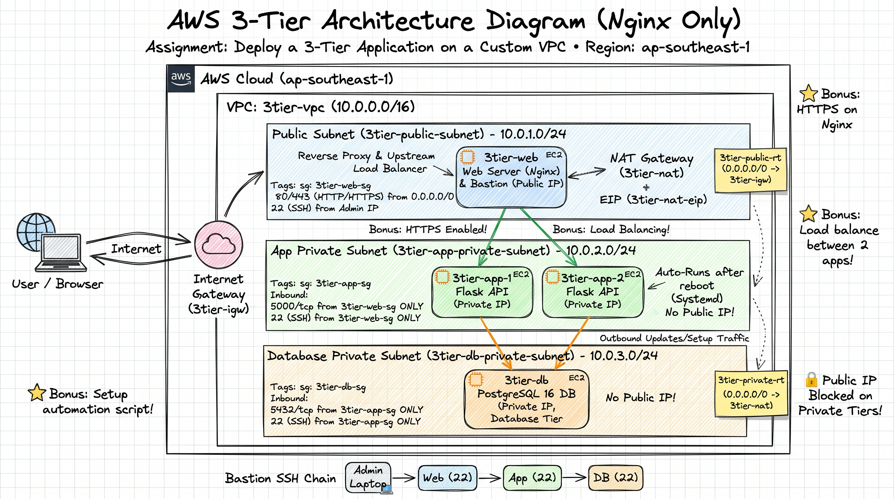
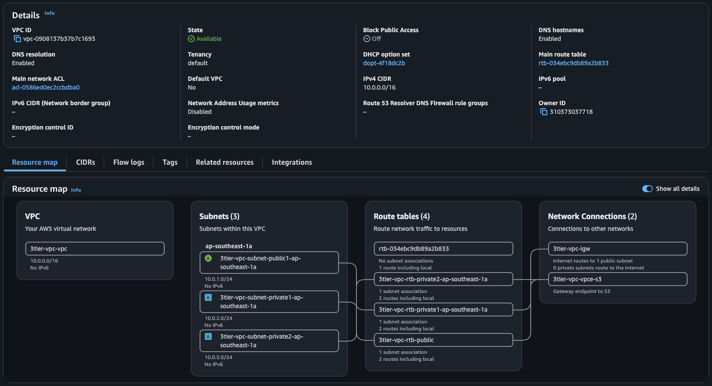
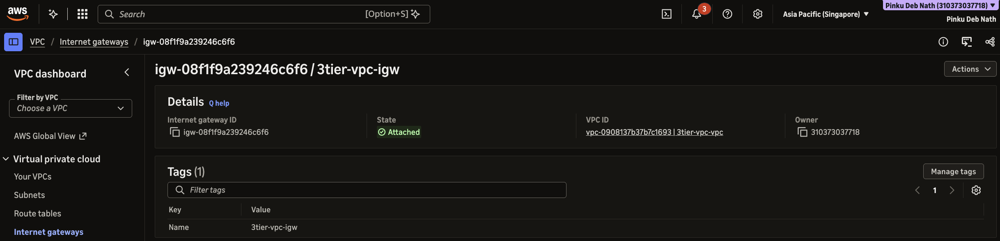
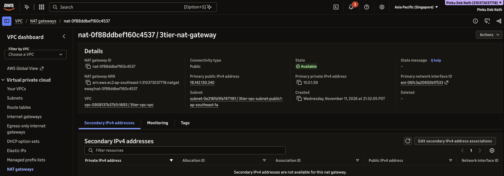

# Deploy 3 Tier Application in AWS VPC


## Architecture Diagram



## Steps

### 1. Create VPC, IGW and 3 Subnets, verify public IP

VPC: `3-tier-vpc`

Subnets:
- Web: `3tier-vpc-subnet-public1-ap-southeast-1a`
- App: `3tier-vpc-subnet-private1-ap-southeast-1a`
- DB: `3tier-vpc-subnet-private2-ap-southeast-1a`


Check current public IPv4 address (for SSH Security Group rules)

```bash
curl -4 -s https://checkip.amazonaws.com
207.81.48.214
```

publicIP: 207.81.48.214

Create VPC using AWS Console



IGW:



### 2. Allocate Elastic IP, & create the NAT Gateway in the public subnet

IGW: `3-tier-igw`

EIP: `3-tier-nat-eip`

NAT Gateway: `3-tier-nat-gateway`

```bash

```

### 3. Enable Auto-assign public IPv4 on the Web Public Subnet (subnet-0e216fd3fe7471181)
```bash
aws ec2 modify-subnet-attribute \
  --subnet-id subnet-0e216fd3fe7471181 \
  --map-public-ip-on-launch \
  --profile ostad \
  --region ap-southeast-1
```

### 4. Create the NAT Gateway (3tier-nat-gateway) in the Public Subnet using Elastic IP eipalloc-0f929bf91faf1ed01



